# OUTLAW ビデオ信号ジェネレータ 取扱説明書

2026-11-27 時点。

## 1. はじめに

この機器は、昔のパソコン・ゲーム機・アーケード基板の映像信号のタイミングを、ドットクロックから同期の形まで柔軟に設定できるビデオ信号ジェネレータです。モニタ・アップスキャンコンバータ・キャプチャ機器の対応範囲の確認を主な目的としています。

できること:

- 水平・垂直の表示・フロントポーチ・同期・バックポーチを 1 ドット / 1 ライン単位で設定し、出力します。
- VGA 端子と JAMMA 端子に出力します。
- テレビ出力 (コンポジット・S 端子) は、NTSC / PAL など 6 方式に対応しています。
- ドットクロックは 1〜48MHz で、ボタンでは最小 100Hz 単位で設定できます (内蔵プリセット・キャプチャの COPY では 1Hz 単位)。
- 複合同期 (OR / XOR / 等化パルス付き)、インターレース、ラインの途中で切り替わる VSYNC を再現できます。
- 内蔵プリセットは 42 個 (PC-98・X68000・MSX2・ファミコン・アーケード基板など) です。自分で作った設定 (ユーザープリセット) を 8 個まで保存できます。
- テストパターン 10 種と、画面への情報表示 (OSD) があります。
- 光センサーで表示遅延を測定する機能があります (センサー部はオプション)。
- VGA 端子に外部機器をつないで、そのタイミングを測って推定する機能 (キャプチャ) と、同期の波形をそのまま写して再生する機能 (波形コピー) があります。

<!-- この説明書は、ファームウェアのブランチ capture-meas の 2026-11-27 時点の機能 (メニューは 2 段) を説明します。キャプチャと波形コピー (11・12 章) は、映像入力の回路がある改版の基板でだけ使えます。今の基板では最初の画面の SYNC CAPTURE を使わないでください。 -->

### ご使用の前に (必ずお読みください)

本機は個人が設計・製作した同人ハードウェアです。メーカーの製品のような品質の保証・検査・各種の認証はありません。次の内容を確かめ、同意したうえでお使いください。

**免責**

- 本機の故障・不具合、または本機を使ったことによって、つないだ機器 (モニタ・テレビ・パソコン・ゲーム機・アーケード筐体・キャプチャ機器など) の故障や破損、データの消失などの損害が生じた場合、製作者の故意または重大な過失によるときを除き、責任を負いかねます。ご理解のうえご利用ください。
- 製作者の軽い過失による損害で、製作者が責任を負うときも、その額は本機の代金を上限とします。
- 法律で責任を制限できない場合 (製造物責任法による場合など) は、法律に従います。
- 説明書の注意を守り、つなぐ機器の仕様を確かめたうえで、お使いになる方の判断でお使いください。
- 回路図・ファームウェアは BSD 3-Clause ライセンスに従い、無保証です (リポジトリの `LICENSE`)。

**動作について**

- 動作の確認には万全を期していますが、すべての機器・設定・環境での正しい動作を保証するものではありません。シミュレーションでは確かめていても、実機では確認できていない部分もあります。
- 内蔵プリセットの値は、資料・実測・エミュレータの設定などを参考とした値です。元の機器と完全に同じ信号であることは保証しません。
- 測定の結果 (周波数・表示遅延・キャプチャの推定など) は目安で誤差があります。厳密な測定が要るときは、校正された測定器でお確かめください。

**つなぐ機器を守るために**

> [!CAUTION]
> 機器の故障の原因になることがあります。十分にご注意ください。

- 相手の機器が受けられる信号 (水平・垂直の周波数、同期の電圧 LOW / TTL、同期の形式、インターレース) をお確かめください。
- 対応していない周波数の信号を、固定周波数のモニタ (アーケードのモニタ・古い CRT のモニタやテレビなど) に接続しないでください。回路を傷めることがあります。映らない・異音・異臭など異常があるときは、すぐに信号を止めるか電源を切ってください。
- TTL の同期 (5V 前後) は、75Ω で受ける機器に入れないでください。故障のおそれがあります (2 章の注意、5 章の SYNC LV)。
- ケーブルの抜き差しは、本機と相手の機器の電源を切ってから行ってください。
- JAMMA エッジコネクタは、向きとピン配置を確かめてから挿してください。逆挿し、横ズレ、配線の間違いは、本機と筐体両方の故障の原因となります。
- 同じ絵 (特に WHITE・GRID などの明るいパターンや OSD) を長い時間出したままにすると、CRT・プラズマ・有機 EL の画面に焼き付きが残ることがあります。
- 本機が出力モードのときに、他の機器の出力をつながないでください (2 章の注意)。

**安全のために**

- 電源は USB Type-C の 5V を使ってください。指定外の電源・電圧をつながないでください。
- 煙・異常な発熱・においなどに気づいたら、すぐに電源を外して使用を中止してください。
- 本機は基板がむき出しのため、金属の上に置いたり、導電性のものを近づけたりしないでください (ショートのおそれ)。触る前に金属に触れるなどして、体の静電気を逃がしてください。
- 水・湿気・ほこりの多い所、直射日光の当たる所、高温になる所で使ったり置いたりしないでください。
- 小さなお子さまの手の届かない所で使い、保管してください。
- CRT のモニタの調整などで中を開けるときは、高電圧に十分注意してください。本機の取り扱いとは関係なく危険です。
- 本機は電波・電磁的な妨害 (EMC) の試験を受けていません。ほかの機器に雑音が入るときは、使用を中止するか、対策を講じた上で使用してください。

**保存データ**

- ユーザープリセット・波形コピーのデータは、本機の EEPROM に保存します。故障・更新・操作の間違いなどで消えたり壊れたりすることがあります。大事な設定は、値を控えておいてください。

**改造・商標**

- 改造・修理は、ご自身の責任で行ってください。改造した基板の動作・安全は保証しません。
- PC-9801・PC-8801・X68000・X1・FM-7・FM-16β・MB-S1・FP-1100・MSX・ファミコン・メガドライブ・Macintosh・Amiga・Commodore 64・タイトー F3・マッピー などは、各社の商標または登録商標です。本機はこれらの会社とは関係がなく、公式の製品ではありません。プリセットの名前は、映像の形を分かりやすくするために機種名を使っています。

## 2. 各部の名前と接続

電源は USB Type-C の 5V です。映像は VGA 端子と JAMMA 端子に同じものが出ます。

| 端子・部品 | 用途 |
| --- | --- |
| USB Type-C | 電源 (5V) |
| VGA (DE-15) | 映像出力 (RGB 各 4 ビット + HSYNC / VSYNC)。映像入力にも切り替えて使う |
| JAMMA エッジコネクタ | 映像出力 (アーケードの筐体・モニタ用) |
| RCA | テレビ出力: コンポジット (CVBS) |
| S 端子 | テレビ出力: Y / C |
| 光センサーのコネクタ | 表示遅延の測定で使うフォトダイオードをつなぐ |
| OLED (128×64) | メニューの表示 |
| ボタン 4 個 | SEL / UP / DOWN / STEP (4 章) |
| リセットボタン | 最初からやり直す (保存したユーザープリセットは消えない) |
| 入出力の切り替えスイッチ | OUT = 出力、IN = VGA 端子で映像を受ける。IN のあいだは出力を止める |
| 終端の切り替えスイッチ | 入力の RGB を 75Ω で終端するかどうか。アナログ RGB は 75Ω 、デジタル (TTL) の RGB は TTL。同期は終端なし。 (11 章) |

注意:

- 出力のまま別の機器の出力と VGA 端子でつながないでください。信号の衝突を検出すると出力を停止します (`CLASH`) が、入力を受けるときは先にスイッチを IN にしてください。
- 同期の電圧 (SYNC LV) の初期値は LOW (0.6V、75Ω 入力のモニタ向け) です。TTL の同期が要る機器では SYNC LV を TTL にします (5 章)。
- 出している同期が LOW のときに TTL へ上げる APPLY は、安全を考慮し `TTL OK?` と出して止まります。接続機器が TTL の同期信号に対応していることを確かめてから、もう一度 APPLY してください (内蔵プリセット・LOAD で TTL になる場合も同じ)。

## 3. 画面の見方

操作は OLED のメニューで行います。VGA 出力には、今の出力の値を示す OSD と、操作中のメニューが重なります。

### メニューの階層

メニューは 2 段です。電源を入れると最初の画面になり、使う機能を 3 つから選びます。

```
STEP           1
SYNC SET/PATTERN   ← 映像タイミングの設定・テストパターン・プリセット・保存・APPLY (5〜9 章)
LAG CHECK          ← 表示遅延の測定 (10 章)
SYNC CAPTURE       ← 映像入力の測定・波形コピー (11・12 章)
```

- UP / DOWN で選び、SEL でその機能の項目一覧に入ります。
- 各一覧の一番上の行 `<< BACK` で SEL を押すと、最初の画面に戻ります。
- 一覧の一番下で DOWN を押すと、一番上 (`<< BACK`) に戻ります。
- 機能によって MODE が切り替わります。LAG CHECK に入ると MODE は遅延測定の範囲 (LAG FULL / TOP / CENT / BOT)、SYNC CAPTURE に入ると映像入力 (CAP SELF / CAP RAW) から選びます。SYNC CAPTURE から SYNC SET/PATTERN・LAG CHECK に入ると、波形の再生はやめます。入力 / 出力は切り替えスイッチだけで決まります。
- 確定が要るとき (プリセットを選んだ・ぶつかりを検出したなど) にカーソルが APPLY へ移るときは、APPLY のある一覧 (SYNC SET/PATTERN、または SYNC CAPTURE) へ移ります。

<div class="shots">
<figure>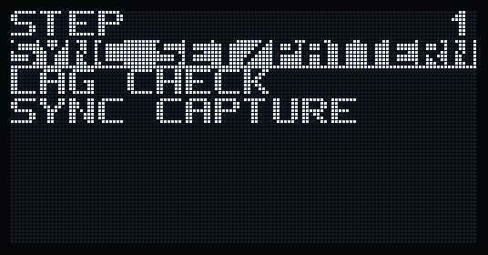<figcaption>最初の画面 (電源を入れたとき)。UP / DOWN で選んで SEL</figcaption></figure>
<figure>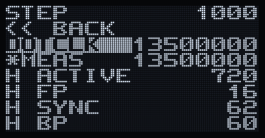<figcaption>SYNC SET/PATTERN の一覧。一番上は <code>&lt;&lt; BACK</code></figcaption></figure>
<figure>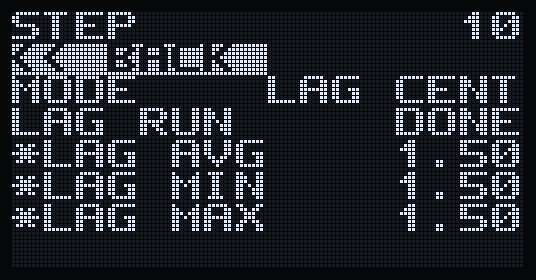<figcaption>LAG CHECK の一覧</figcaption></figure>
<figure>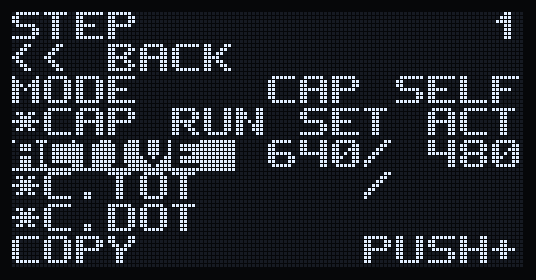<figcaption>SYNC CAPTURE の一覧 (入った直後。カーソルは ACTIVE)</figcaption></figure>
</div>

### OLED

16 文字 × 8 行です。1 行目が増減幅、2〜8 行目がメニューの項目 7 個です。

```
STEP *        10   ← 1 行目: 増減幅。未確定の変更があると *
DOTCLK  25175000   ← 2〜8 行目: 項目名と値
*MEAS   25166000      選んでいる項目は項目名を反転表示
```

- 選んでいる項目は、項目名が白黒反転します。値を変えているあいだは、変える桁が点滅します。
- 項目名の頭の `*` は、変更できない項目の印です (実測値・合計・測定結果、TV OUT で固定された項目など)。
- 値が `----` の項目は、今の設定では使われない項目です。
- 1 行目 (`STEP` の行) の `*` は、APPLY で確定していない変更があるときに付きます。波形コピーで RAW REC・RAW LOAD をしたあと、APPLY で再生を始めるまでも付きます (設定が出力と同じでも)。

### VGA 出力の OSD

画面の中央に、今出している設定 (APPLY で確定した値) と実測値を重ねます。電源を入れたときは表示されています。UP + DOWN の同時押しで表示 / 非表示を切り替えます。

OSD はどの解像度でも拡大せず、いつも 256 × 64 ドット (8 × 8 ドットの文字で 32 文字 × 8 行) の大きさで出ます。画面に対する OSD の大きさで、解像度の目安が分かります (320 ドット幅ならほぼ横いっぱい、768 ドット幅なら 1/3 ほど)。

```
DOT CLOCK   34.775995 MHz        ← ドットクロック (設定値)
MEASURED    34.776000 MHz        ← ドットクロック (実測)
  |ACTIVE|  FP|SYNC|  BP|TOTAL
H |   768|  72| 120| 144| 1104   ← 水平 [ドット]
V |   512|  15|   6|  35|  568   ← 垂直 [ライン]
SYNC SEP LOW  HS NEG  VS NEG     ← 同期の形式・電圧・極性
H FREQ      31.600 kHz           ← 水平周波数 (実測)
V FREQ       55.45 Hz            ← 垂直周波数 (実測)
```

### メニュー選択中の表示

ボタンを押すと、5 秒間だけ OLED と同じメニュー (16 文字 × 8 行) が画面にも出力されます。OSD を消していても出るので、OLED が見えない場所でも操作できます。
遅延の測定中は出力されません。

## 4. 基本操作

値を変えただけでは出力は変わりません。APPLY で確定したときに反映されます。

> [!TIP]
> SEL長押しで即時APPLYが可能です。

### 電源を入れたとき

電源を入れると、約 1 秒で次の設定を確定して出力を始めます。OLED はメニューの最初の画面 (3 章) になります。

1. ユーザープリセットの **スロット 1 に保存があれば、その設定** (7 章)
2. スロット 1 に何も入っていなければ、**内蔵プリセット 0 の NTSC240P** (720×240、13.5MHz、15.73kHz / 60.05Hz。6 章)

いつも同じ設定 (たとえば VGA60) で始めたいときは、その設定をスロット 1 に SAVE しておきます。NTSC240P は 15kHz なので、31kHz だけの VGA モニタでは映りません。そのときは PRESET で VGA60 などを選んで APPLY してください。

### ボタンの早見表

| 操作 | 動作 |
| --- | --- |
| UP / DOWN | 項目移動 (今の一覧の中で。一番下の次は一番上)。値変更モードでは値を増やす / 減らす (長押しで連続) |
| SEL | 値変更モードに入る・出る (決定)。LOAD / SAVE / APPLY / 測定の項目ではその場で実行。最初の画面の行ではその一覧へ入り、`<< BACK` では最初の画面に戻る。EQ FORM では欄を決定して次の欄へ (最後の欄で出る) |
| SEL 長押し | 値を決定して出て、APPLY へ移って確定 |
| STEP | 増減幅を ×1 → ×10 → ×100 → ×1000 と切り替える (DOTCLK は 1k → 10k → 100k → 1M → 100 [Hz])。NAME では次の文字 (ACTIVE は ×1 → ×10 → ×100) |
| STEP 長押し | APPLY (確定) |
| UP + DOWN 同時押し | VGA 出力の OSD を消す / 出す |
> [!TIP]
> JAMMA接続時　レバー上下は UP DOWN　として、トリガは　STEP　として、1Pスタート　は　SEL　として動作します。

### 値を変えて確定する

1. 最初の画面で SYNC SET/PATTERN に入り、UP / DOWN で項目を選ぶ。
2. SEL で値変更モードに入る。
3. 数値の項目は STEP で増減幅を選び、UP / DOWN で値を変更する。選択肢の項目は UP / DOWN で選ぶ。
4. SEL で値を決定し、値変更モードを抜ける。1 行目 (`STEP` の行) に `*` が出る (まだ出力には反映されていない)。
5. ほかの項目も同じように変える。
6. APPLY (No.25) で SEL を押す (どの項目にいても STEP 長押しで同じ)。出力をいったん止めてクロックを切り替え、新しいタイミングで出力を再開する。
7. APPLY の表示が `OK` になり、`*` が消えれば完了。

<div class="shots">
<figure>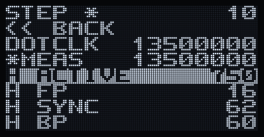<figcaption>値の変更: H ACTIVE を ×10 で 750 に (値が点滅、1 行目に <code>*</code>)</figcaption></figure>
<figure>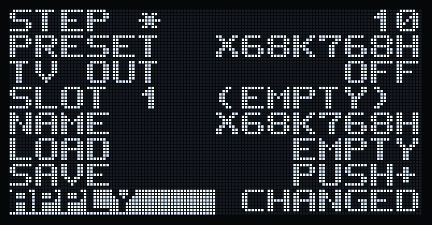<figcaption>PRESET を決定したあと: カーソルが APPLY へ移り <code>CHANGED</code></figcaption></figure>
<figure>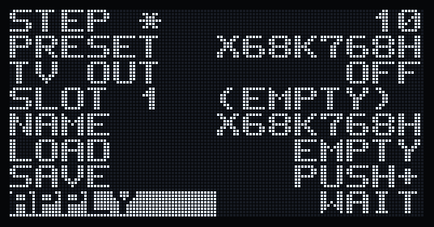<figcaption>APPLY の処理中 (<code>WAIT</code>)</figcaption></figure>
<figure>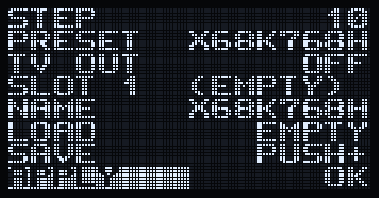<figcaption>確定したあと (<code>OK</code>、<code>*</code> が消える)</figcaption></figure>
</div>

APPLY の表示:

| 表示 | 意味 |
| --- | --- |
| `OK` | 作業中の値と出力が同じ |
| `CHANGED` | 未確定の変更がある |
| `WAIT` | 確定の処理中 (クロックが合うのを待っている)。この間はボタンを受け付けない (UP + DOWN の OSD の切り替えだけは効く) |
| `CLK ERR` | ドットクロックの実測が目標に合わなかった。もう一度 APPLY するとクロックを書き直して確かめる |
| `TTL OK?` | 同期の電圧を LOW から TTL に上げる確定の確かめ。もう一度 APPLY (SEL / STEP 長押し) で確定する。カーソルを APPLY から離すと取り消し |
| `CLASH` | 映像入力と出力の衝突を検出して、出力を止めた。接続を直して APPLY で戻る |

APPLY の処理中 (`WAIT` の間、1 秒くらいまで) はボタンを受け付けません。終わってから操作してください。LOAD・SAVE の途中 (`BUSY`) に APPLY を押しても始まりません。終わってから押し直してください。プリセットを選んだとき・LOAD したときは、カーソルが自動で APPLY へ移ります。

## 5. 映像タイミングの設定

水平はドット、垂直はラインの単位で、表示・フロントポーチ (FP)・同期・バックポーチ (BP) をそれぞれ設定します。合計と周波数は自動で計算して表示します。

| No. | 項目 | 範囲・選択肢 | 説明 |
| --- | --- | --- | --- |
| 0 | DOTCLK | 1〜48MHz (ボタンでは最小 100Hz 単位。STEP で 1k → 10k → 100k → 1M → 100) | ドットクロック |
| 1 | MEAS | 表示のみ | ドットクロックの実測 (10Hz 単位) |
| 2〜5 | H ACTIVE / FP / SYNC / BP | 表示 8〜2000、FP 0〜512、SYNC 1〜512、BP 0〜1024 \[ドット\] | 水平の内訳 |
| 6〜9 | V ACTIVE / FP / SYNC / BP | 表示 1〜2048、FP 0〜256、SYNC 1〜64、BP 0〜512 \[ライン\] | 垂直の内訳 |
| 10 / 11 | HS POL / VS POL | POS / NEG | 同期の極性。NEG = 同期のあいだ Low |
| 12 | SYNC | SEP / OR / XOR / EQ | 同期の形式 (下の表) |
| 13 | SYNC LV | TTL / LOW 0.6V | 同期の電圧。TTL は約 3.3V、LOW は 75Ω 入力のモニタ向け (初期値)。LOW から TTL に上げる APPLY は確かめ (`TTL OK?`) が入る |
| 14 | VS OFS (EQ のときは EQ FORM) | 0〜H 合計 - 1 \[ドット\] | VSYNC が切り替わる位置 |
| 15 | SCAN | PROG / INTER | プログレッシブ / インターレース |
| 16 | TOTAL | 表示のみ | H / V の合計 (`858/ 525`) |
| 17 | FRQ | 表示のみ | 水平 \[kHz\] / 垂直 \[Hz\] の周波数 (`15.98k 62.42`) |

<div class="shots">
<figure>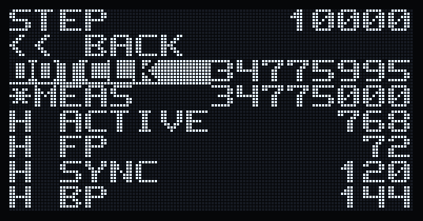<figcaption>DOTCLK (目標) と MEAS (実測)</figcaption></figure>
<figure>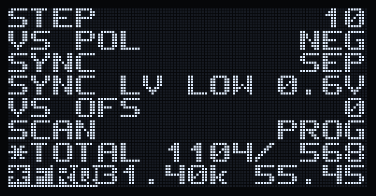<figcaption>VS OFS・SCAN・TOTAL・FRQ (水平 / 垂直周波数)</figcaption></figure>
</div>

### 同期の形式 (SYNC)

| 選択肢 | 出力 |
| --- | --- |
| SEP | HSYNC と VSYNC を別々のピンに出す |
| OR | 複合同期 (CSYNC)。H と V の同期の OR |
| XOR | 複合同期。垂直同期のあいだ H の同期を反転する形 |
| EQ | 等化パルスと切れ込み (セレーション) の付いた複合同期。テレビ方式や MSX2 と同じ形 |

- 複合同期 (OR / XOR / EQ) では HSYNC のピンに CSYNC が出て、VSYNC のピンは動きません。受ける側が H / V 別々と取り違えないためです。
- SEP から複合同期にすると、SYNC LV が LOW になります (あとで TTL に戻せます)。
- EQ にするとき・EQ から戻すときは、VS OFS が 0 に戻ります。

### VSYNC の切り替え位置 (VS OFS)

VSYNC が切り替わる位置を、H の同期の始まりからのドット数で指定します。0 なら H の同期と同時です。PC-8801 や X1 のように、VSYNC がラインの途中 (表示の始まりなど) で切り替わる機種を再現するときに使います。それらの内蔵プリセットには実機の値が入っています (例　PC-8801FA では 168)。

### EQ の形 (EQ FORM)

SYNC が EQ のとき、No.14 は EQ FORM になり、`  E 4 8 6 ` のように 4 つの欄で等化パルスの形を決めます。SEL で変更開始、UP / DOWN で値を変更し、SEL でその欄を決定して次の欄へ移ります。最後の欄 (数) で SEL を押すと決定して終わります (STEP は使いません)。

| 欄 | 意味 | 選択肢 |
| --- | --- | --- |
| 1 | 半ラインずれ | `E` 通常 / `O` 毎フィールド奇数フィールドの形 (プログレッシブのときだけ効く) |
| 2 | 等化パルスの幅 | H 同期の幅 × 1/8〜8/8  |
| 3 | 切れ込みの幅 | H 同期の幅 × 1/8〜8/8 |
| 4 | 等化パルスの数 | 前後それぞれ 6 / 7  |

`  E 4 8 6 ` が NTSC の形です。タイトー F3 (odd-odd field、等化パルス 7 個、切れ込みは H 同期の半分) は `  O 4 4 7 ` です。V FP が短い (3 ラインなど) と、最初の等化パルスが表示のあるラインにかかるので出ません。

### インターレース (SCAN = INTER)

偶数フィールドと奇数フィールドを交互に出し、垂直同期を半ラインずらします。V ACTIVE は 1 フレーム (2 フィールド) のライン数、V FP / SYNC / BP は 1 フィールドのライン数で指定します (例: NTSC480I は V ACTIVE 480、FP 3、SYNC 3、BP 16)。複合同期では等化パルスと広いパルスも作ります。

## 6. 内蔵プリセット

No.19 PRESET で 42 個の内蔵プリセットから選べます。SEL で入り、UP / DOWN で名前を選んで SEL で決定すると、ドットクロック・タイミング・極性・同期の形式・名前が作業中の値に入り、カーソルが APPLY へ移ります。もう一度 SEL で出力に入ります。並びは下の表の順 (テレビ → 家庭用 → 国内 PC → PC-98 → X68000 → VGA → 海外の PC → アーケード) です。電源を入れたときは、スロット 1 に保存がなければ 0 NTSC240P になります (4 章の「電源を入れたとき」)。

| No. | 名前 | DOTCLK \[MHz\] | 表示 | 水平 \[kHz\] | 垂直 \[Hz\] | 同期 |
| --- | --- | --- | --- | --- | --- | --- |
| 0 | NTSC240P | 13.5 | 720×240 | 15.73 | 60.05 | SEP N/N |
| 1 | PAL 288P | 13.5 | 720×288 | 15.62 | 50.08 | SEP N/N |
| 2 | NTSC480I | 13.5 | 720×480 | 15.73 | 59.94 | SEP N/N・インターレース |
| 3 | PAL 576I | 13.5 | 720×576 | 15.62 | 50.00 | SEP N/N・インターレース |
| 4 | MSX | 5.36932 | 256×192 | 15.70 | 59.92 | XOR N・LOW |
| 5 | FAMICOM | 5.36932 | 256×240 | 15.75 | 60.10 | XOR N・LOW |
| 6 | MSX2 192 | 10.7386 | 512×192 | 15.70 | 59.92 | EQ N・LOW |
| 7 | MSX2 212 | 10.7386 | 512×212 | 15.70 | 59.92 | EQ N・LOW |
| 8 | MSX2 424 | 10.7386 | 512×424 | 15.70 | 59.81 | EQ N・LOW・インターレース |
| 9 | MSX2P192 | 10.7386 | 512×192 | 15.70 | 50.16 | EQ N・LOW |
| 10 | MSX2P212 | 10.7386 | 512×212 | 15.70 | 50.16 | EQ N・LOW |
| 11 | MD H40 | 6.71165 | 320×224 | 15.72 | 59.99 | XOR N・TTL |
| 12 | PC80/88L | 14.3182 | 640×200 | 15.98 | 62.42 | SEP N/N・TTL・VS OFS 168 |
| 13 | PC-88 HI | 21.0526 | 640×400 | 24.83 | 55.42 | SEP N/N・TTL・VS OFS 120 |
| 14 | X1 | 14.3182 | 640×200 | 15.98 | 61.94 | SEP N/N・TTL・VS OFS 184 |
| 15 | X1 40 | 7.15909 | 320×200 | 15.98 | 61.94 | SEP N/N・TTL・VS OFS 88 |
| 16 | X1TURBO | 21.4773 | 640×400 | 24.86 | 55.49 | SEP N/N・TTL・VS OFS 152 |
| 17 | FM-7 | 16.128 | 640×200 | 15.75 | 60.11 | XOR N・TTL |
| 18 | MB-S1 | 16.128 | 640×200 | 15.75 | 60.11 | SEP N/N・VS OFS 264 |
| 19 | FM16B200 | 16.128 | 640×200 | 15.75 | 60.11 | SEP N/N・VS OFS 224 |
| 20 | FM16B400 | 21.0526 | 640×400 | 24.37 | 55.38 | SEP N/N・VS OFS 160 |
| 21 | FP11 40 | 7.9872 | 320×200 | 15.60 | 59.77 | SEP N/N・VS OFS 128 |
| 22 | FP11 80 | 15.9744 | 640×200 | 15.60 | 59.77 | SEP N/N・VS OFS 256 |
| 23 | PC-98 | 21.0526 | 640×400 | 24.83 | 56.42 | SEP N/N |
| 24 | PC98 GDC | 21.0526 | 640×400 | 24.83 | 56.42 | SEP N/N |
| 25 | PC98HR | 47.8150 | 1120×750 | 32.84 | 80.00 | SEP N/N・インターレース |
| 26 | X68K768H | 34.776 | 768×512 | 31.50 | 55.46 | SEP N/N |
| 27 | X68K512H | 23.184 | 512×512 | 31.50 | 55.46 | SEP N/N |
| 28 | X68K384H | 17.388 | 384×512 (256 ライン × 2) | 31.50 | 55.46 | SEP N/N |
| 29 | X68K256H | 11.592 | 256×512 (256 ライン × 2) | 31.50 | 55.46 | SEP N/N |
| 30 | X68K640H | 25.175 | 640×480 | 31.47 | 59.94 | SEP N/N |
| 31 | X68K24K | 34.776 | 1024×424 | 24.70 | 53.12 | SEP N/N |
| 32 | X68K24KI | 34.776 | 1024×848 | 24.70 | 53.06 | SEP N/N・インターレース |
| 33 | X68K15K | 4.858 | 256×240 | 15.98 | 61.46 | SEP N/N |
| 34 | X68K15KI | 9.716 | 512×480 | 15.98 | 61.34 | SEP N/N・インターレース |
| 35 | VGA60 | 25.175 | 640×480 | 31.47 | 59.94 | SEP N/N |
| 36 | VGA70 | 25.175 | 640×400 | 31.47 | 70.09 | SEP N/P |
| 37 | MAC 128K | 15.6672 | 512×342 | 22.25 | 60.15 | SEP N/N |
| 38 | AMIGA | 7.15909 | 320×200 | 15.73 | 60.05 | XOR N・TTL |
| 39 | C64 | 8.18182 | 418×235 | 15.73 | 59.83 | XOR N・LOW |
| 40 | TAITO F3 | 6.6715 | 320×232 | 15.44 | 58.94 | EQ N・TTL・EQ FORM `O 4 4 7` |
| 41 | MAPPY | 6.144 | 288×224 | 16.00 | 60.61 | XOR N・TTL |

- 同期の欄の読み方: 形式 (SEP = H / V 別々、OR / XOR / EQ = 複合同期)、極性 (SEP は HS / VS、複合同期は 1 本なので N だけ。N = 負、P = 正)、同期の電圧 (TTL / LOW。書いていないものは PRESET を選び始める前の値のまま)、VS OFS (書いていないものは選び始める前の値のまま。複合同期のプリセットは 0)、EQ FORM (EQ のときの形。書いていないものは NTSC の形 `E 4 8 6`)、インターレースの順です。
- プリセットを選んだあとに、プリセットが入れる値 (DOTCLK・H / V・極性・SYNC・SYNC LV・VS OFS / EQ FORM・SCAN) を手で変えたとき、LOAD したとき、キャプチャの COPY をしたときは、PRESET の欄が `(CUSTOM)` になります。作業中の値が表示中のプリセットと違うことを示す印で、プリセットを選び直すと消えます。PATTERN・NAME を変えても `(CUSTOM)` にはなりません。
- 複合同期のプリセットは、同期の電圧 (SYNC LV) も実機に合わせて入ります (FM-7 / MD H40 / AMIGA / TAITO F3 / MAPPY は TTL、MSX / FAMICOM / C64 / MSX2 系は LOW)。
- PC-88 HI / PC80/88L / X1 / X1TURBO / X1 40 は、SYNC LV を TTL にし、VS OFS も実機の値を入れます。ほかの SEP のプリセットは、SYNC LV と VS OFS を選ぶ前の値のままにします。
- X68K で始まる 9 個は X68000 の画面モードです (名前の H は 31kHz、24K / 15K は 24kHz / 15kHz、最後の I はインターレース)。値は CRTC の標準の設定値から計算しています。X68K24KI と X68K15KI のインターレースの 1 フィールドのライン数が実機と同じかは確かめていません。
- PC-98 は従来の設定値、PC98 GDC は GDC (μPD7220A) に PC-9801F の ROM の設定を入れた実測値です。
- MSX は映像 LSI TMS9918 のタイミングです。同じ LSI を使うぴゅう太・SG-1000・コレコビジョンなどもこのプリセットで同じ出力になります。
- MB-S1 は日立 MB-S1 の 80 桁 (640×200) です。同期の形式・極性・電圧は資料がなく推定で、VSYNC の位置 (VS OFS 264) も入ります。同期の電圧は PRESET を選び始める前の値のままです。
- FM16B200 / FM16B400 は富士通 FM-16β の 200 ライン・400 ラインです。V FP が 0 (表示の直後に垂直同期) です。同期の形式・極性・電圧は推定で、200 ラインのドットクロック (16.128MHz) も推定です。VS OFS (224 / 160) も入ります。
- FP11 40 / FP11 80 はカシオ FP-1100 の 40 桁・80 桁です。値は推定で (合計は 15.60kHz / 59.77Hz)、同期の形式・極性・電圧も推定です。VS OFS (128 / 256) も入ります。
- TAITO F3 はタイトー F3 基板です。同期は EQ で、EQ FORM に F3 の形 (`  O 4 4 7 `、毎フィールド半ラインずれ・等化パルス 7 個) が入ります。FP / 同期 / BP の分け方は推定です。
- MAPPY はナムコのマッピー / スーパーパックマン / ドルアーガの塔 / ディグダグ II などの基板です。同期の位置は実測の値で、複合同期は XOR (負極性) です。どちらも同期の電圧は TTL (JAMMA) です。
- PC98HR は PC-98XA / XL / RL などのハイレゾ (32.84kHz のインターレース) で、NEC のテクニカルデータブックのタイミング表の値です。ドットクロックが 47.8MHz と高いため環境により表示困難なばあいがあります。
- 値は MAME の画面設定、CRTC の設定値、回路図、実機の実測、V9938 のデータシート等を元にしており、実機と異なる場合があります。

<div class="shots">
<figure>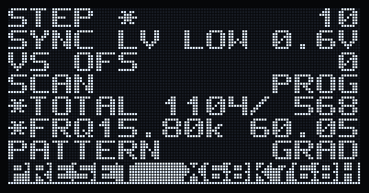<figcaption>PRESET で X68K768H を選んでいるところ (SEL で決定)</figcaption></figure>
</div>

## 7. ユーザープリセット

自分で作った設定を、名前 (8 文字) を付けて EEPROM の 8 スロットに保存できます。保存するのはテストパターン以外の全部の設定 (タイミング・同期・VS OFS / EQ FORM・SCAN・TV OUT など) です。

| No. | 項目 | 使い方 |
| --- | --- | --- |
| 21 | SLOT | スロット 1〜8 を選ぶ。そのスロットに保存した名前も表示する (空なら `(EMPTY)`) |
| 22 | NAME | 保存する名前。SEL で入り、STEP で次の文字へ、UP / DOWN で文字を変える。使える文字は 空白 A〜Z 0〜9 - + . / \_ |
| 23 | LOAD | SEL で選んだスロットを読み出して作業中の値に入れる。確定が要ればカーソルが APPLY へ移る |
| 24 | SAVE | SEL で今の作業中の値を選んだスロットに書く |

LOAD / SAVE の表示:

| 表示 | 意味 |
| --- | --- |
| `PUSH+` | SEL ボタンで実行待ち |
| `BUSY` | 読み書き中 |
| `LOADED` / `SAVED` | ロード・セーブ完了 |
| `EMPTY` | (LOAD) そのスロットには何も保存されていない |
| `ERROR` | (LOAD) 中身が壊れている。(SAVE) ベリファイ失敗 |

- LOAD してもテストパターンは変わりません。
- SAVE は SEL を押した瞬間の値を書きます。書いている途中に値を変えても影響しません。
- LOAD した値も、APPLY するまでは出力開始しません。
- **スロット 1 は電源を入れたときに自動で読み込み、そのまま確定して出力します**。スロット 1 に何も入っていなければ、内蔵プリセット 0 の NTSC240P で始まります (4 章の「電源を入れたとき」)。よく使う設定はスロット 1 に SAVE しておくと、電源を入れたときからその設定になります。スロット 1 を読み込んだときの PRESET の欄は `(CUSTOM)` になります (名前は NAME に出ます)。

<div class="shots">
<figure>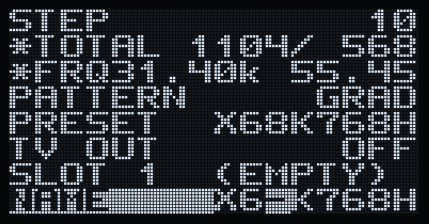<figcaption>NAME の編集 (STEP で桁を移り、その桁が点滅)</figcaption></figure>
</div>

## 8. テストパターン

No.18 PATTERN で 10 種から選びます。パターンは APPLY なしですぐ切り替わり、表示サイズに合わせて描き直されます (外枠と中央十字はいつも画面の端と中央)。

| No. | 名前 | 絵 | 使いどころ |
| --- | --- | --- | --- |
| 0 | SMPTE | SMPTE のカラーバー。上 2/3 に 75% の 7 本 (白・黄・シアン・緑・マゼンタ・赤・青)、中段に逆順の帯、下 1/4 に -I・100% 白・+Q・黒・PLUGE。VGA は色が各 4 ビットなので 75% は 73%、PLUGE は黒より暗い -4% を出せないので 0% / 0% / +7%。テレビ出力は 8 ビットの正確な値 (75%、-I / +Q は 40 IRE p-p、PLUGE は -4 / 0 / +4 IRE) | 色・明るさの確認 |
| 1 | GRAD | 上から R / G / B / 白、それぞれ 16 段階 | 階調・ガンマ |
| 2 | GRID | 白の外枠、16 ドットごとの灰の格子 (64 ドットごとは明るい灰)、赤の中央十字。マスは解像度によらず 16 ドット × 16 ライン | 表示位置・サイズ合わせ。機種本来のドットの縦横比 (マスが正方形に見えればドットが正方形) |
| 3 | WHITE | 全面白 | 輝度・ムラ |
| 4 | XHATCH | 黒地に白の格子 (16 × 12 マス) | コンバージェンス・直線性・糸巻き / 樽型ゆがみ |
| 5 | DOTS | 格子の交点に 2×2 の白い点 | コンバージェンスの細かい調整・フォーカス |
| 6 | ASPECT | 灰の格子に、白 (2 ドットの太さ) で外枠・中央十字・中央の正方形・画面の高さいっぱいの正方形・四隅の正方形 | 縦横比の調整 |
| 7 | BAR75 | 75% カラーバー | テレビ出力の色の確認 |
| 8 | RAMP | なめらかな階調 | テレビ出力の階調 |
| 9 | MBURST | 0.5・1・2・3・4・5MHz の縦縞 | テレビ出力の解像度 (周波数特性) |

- XHATCH / DOTS / ASPECT は画面を横 16 × 縦 12 マスに分けて描きます。4:3 の画面に映すと、どの解像度でもマスは正方形になります。ASPECT の正方形が横長 (縦長) に見えたら、モニタの横幅 (縦幅) を合わせます。
- GRID のマスは逆に、解像度によらず 16 ドット × 16 ライン (明るい線で 64 × 64) です。4:3 に正しく映した画面で GRID のマスの縦横比を見ると、機種本来のドットの縦横比が分かります (VGA60 は正方形、NTSC240P は横長のドットなので横につぶれた長方形)。
- 7〜9 はテレビ出力用です。テレビ出力では 8 ビットの精度で作ります。VGA 出力では RGB 各 4 ビットの近い絵になります (MBURST は 32〜2 ドット周期の縦縞)。
- テストパターンはユーザープリセットには保存しません。

<div class="shots">
<figure>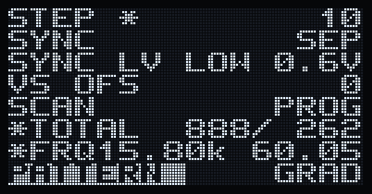<figcaption>PATTERN を GRAD に</figcaption></figure>
</div>

## 9. テレビ出力 (TV OUT)

No.20 TV OUT で方式を選ぶと、RCA (コンポジット) と S 端子にテレビの信号が出ます。VGA 出力も同時に出ています。

選択肢: `OFF`、`NTSC`、`NTSC443`、`PAL`、`PAL-M`、`PAL-N`、`PAL60` と、それぞれの FIX (`NTSC FIX`、`N443 FIX`、`PAL FIX`、`PALM FIX`、`PALN FIX`、`PL60 FIX`)。

### 使い方

1. TV OUT で方式を選んで SEL で決定する。標準のタイミング (NTSC 系は NTSC240P、PAL 系は PAL 288P) が入る。OFF から選んだときと、525 ライン系 (NTSC / NTSC443 / PAL-M / PAL60) と 625 ライン系 (PAL / PAL-N) をまたいで選び直したときだけ入る。同じ系の中での選び直し (NTSC → NTSC FIX など) では、今のタイミングのまま。
2. APPLY で確定する。
3. 必要なら H / V の内訳を変えて APPLY する。FP / BP の配分で絵が左右・上下に動く。

TV OUT が OFF 以外のあいだは、HS POL / VS POL / SYNC / SYNC LV が `----` になり変えられません。VS OFS も変えられません (項目名に `*` が付き、値はそのまま表示)。

### FIX

FIX を選ぶと、水平・垂直の周波数を方式の標準 (NTSC 系 15734.27Hz、PAL 系 15625Hz) に保ちます。H の設定を変えても、ドットクロックと V BP を自動で計算するので、テレビは同期したままです。そのあいだ、DOTCLK は `*DOTAUTO`、V BP は `*VBPAUTO` と表示されます。

### インターレース

SCAN を INTER にすると 480i / 576i で出ます (内蔵プリセットの NTSC480I / PAL 576I も使えます)。等化パルスと広いパルスもテレビの規格どおりに作ります。GRID や XHATCH の 1 ラインの横線が細かくちらつくのは、インターレースでは正常です。

### 知っておくこと

- 画素は 27MHz に打ち直して出すので、ドットクロックによらずテレビに出せます。また、このため映像により画面に斜めの揺れが生じることがありますが、仕様です。
- OSD とメニューの重ね表示はテレビにも出ます。
- その方式に対応しないテレビでは、白黒になったり色が出なかったりします (NTSC443 / PAL60 / PAL-M / PAL-N は対応機種のみ)。
- 31kHz の VGA モニタは 15kHz を映せないことが多いので、TV OUT 中に VGA が映らなくても故障ではありません。

## 10. 表示遅延の測定 (LAG CHECK)

最初の画面で `LAG CHECK` を選びます。一覧は `<< BACK`、No.26 MODE (測定範囲)、No.27〜30 です。

画面の一部を黒から白に切り替え、画面に当てた光センサーが光るまでの時間を 16 回測り、平均・最小・最大を 0.01ms (10µs) 単位で表示します。

### 準備

1. 光センサーをコネクタ (基板の J4) につなぐ。センサーのケーブルの 3 ピンの端子は、**三角印 (▷) が基板の上側 (`J4` と書いてある方) を向く**ように挿す (下の写真)。**逆に挿すと、センサーや本機が壊れるおそれがあります。**
2. 測りたいモニタに映るタイミングを SYNC SET/PATTERN で APPLY しておく。LAG CHECK は今出している (確定した) タイミングのまま、絵だけを測定用の黒・白に替えて測ります。
3. 最初の画面で LAG CHECK に入り、No.26 MODE で測定範囲を選ぶ。選んでいるあいだは範囲が白で出るので、その中央にセンサーを当てる。
4. センサーを画面に押し当て、外の光を入れず、測定中は動かさない。

<div class="shots">
<figure>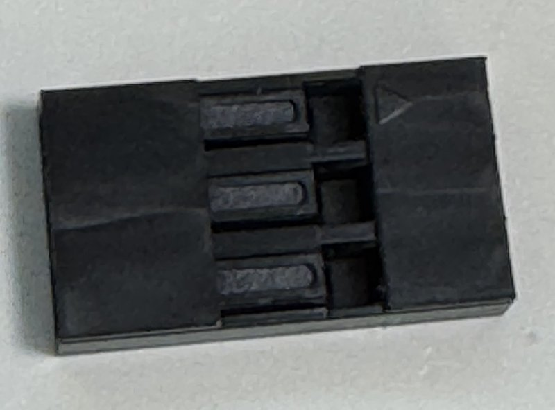<figcaption>光センサーの端子。三角印 (右上の ▷) を、基板の <code>J4</code> と書いてある側 (上側) に向けて挿す</figcaption></figure>
</div>

| MODE | 測定範囲 |
| --- | --- |
| `LAG FULL` | 画面全体 |
| `LAG TOP` | 上の正方形 |
| `LAG CENT` | 中央の正方形 (初期値) |
| `LAG BOT` | 下の正方形 |

上・中央・下で比べると、モニタが画面を書き換える順番の差が分かります。

### 測る

1. No.27 LAG RUN で SEL。`CAL` (センサーの黒・白のレベルからしきい値を自動で合わせる) → `RUN` (16 回測る) → `DONE`。
2. 途中でやめるときはもう一度 SEL (`STOP`)。
3. 結果を No.28〜30 で読む。

| No. | 項目 | 意味 |
| --- | --- | --- |
| 28 | LAG AVG | 測定範囲の中央の画素を出力してから光るまでの平均。モニタ自体の遅れ |
| 29 | LAG MIN | その最小 |
| 30 | LAG MAX | その最大 |

<div class="shots">
<figure>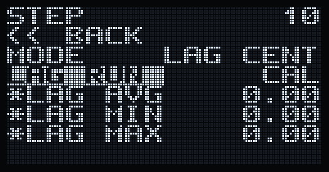<figcaption>LAG RUN で SEL → <code>CAL</code> (しきい値の較正)</figcaption></figure>
<figure>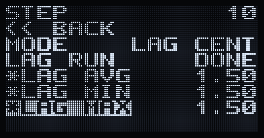<figcaption>測定の結果 (<code>DONE</code>、LAG AVG / MIN / MAX)</figcaption></figure>
</div>

### エラー

| 表示 | 意味 | 対処 |
| --- | --- | --- |
| `LOW SIG` | 黒と白の差が小さい。LAG MIN に黒、LAG MAX に白のセンサーの電圧を `49.50mV` のように出す | どちらも 0 付近ならセンサーがつながっていない・向きが逆・範囲からずれている。どちらも高いなら外の光が強い |
| `NO VIDEO` | 白にする指示から 1 秒たっても範囲を出力しない | 出力が止まっていないか (APPLY 中、入力モードなど) |
| `NO LIGHT` | 1 秒以内に光らない | センサーが動いた、または遅延が 1 秒を超える機器 |
| `NOISE` | 黒のあいだに光を検出した | 外の光・ちらつき。または残像が 250ms 以上残る |

測定中はメニューの重ね表示を出しません。センサー自体の応答で、結果は 0.1〜0.2ms ほど長めに出ます。

## 11. 映像入力の測定 (SYNC CAPTURE: MODE = CAP SELF)

最初の画面で `SYNC CAPTURE` を選びます。一覧は `<< BACK`、No.26 MODE (CAP SELF / CAP RAW)、No.27〜31、No.25 APPLY です。
入ると MODE は `CAP SELF` になり、カーソルは No.28 ACTIVE へ移ります (前に入ったときにキャプチャの MODE のままなら、その MODE で No.26 から)。

外の機器の映像を VGA 端子で受けて、そのタイミング (H / V の内訳・同期・ドットクロック) を推定し、ジェネレータの設定に写せます。

### 入力モードにする

- 入出力の切り替えスイッチを IN にする。入力 / 出力はスイッチだけで切り替わり、入力モードの間は出力が止まる。
- MODE の表示はスイッチに合わせて変わる: スイッチが IN なら `CAP IN`、OUT なら `CAP SELF` (自分の出力をそのまま測る確かめ用)。
  - `CAP SELF` で測るときは、VGA 端子にモニタ (75Ω で受ける機器) をつないでおく。何もつないでいないと出力が終端されず、振幅が大きくなって立ち上がりと立ち下がりの形がそろわないため、幅を 10ns ほど狭く測る (VGA60 で `+78 DONE` のように端数が大きくなる。ドットクロックが高いと H 合計を間違えることもある)。
- MODE の選択肢は `CAP SELF` (`CAP IN`) と `CAP RAW` の 2 つ。
- 終端の切り替えスイッチを入力の RGB に合わせる。
  - **75Ω**: アナログ RGB (0.7V。VGA の機器、アーケード基板、本機の出力など)。
  - **TTL**: デジタル RGB (5V 前後の 0 / 1。PC-8801・X1・FM-7 などの 8 色の RGB)。
  - 決め手は RGB の種類で、同期の電圧 (TTL / LOW) ではありません。同期はスイッチによらず終端しません。たとえば同期が TTL の CSYNC でも、RGB がアナログなら 75Ω にします (本機の MAPPY・TAITO F3 のプリセットなど)。

### 測る前に: 入力の機器に出す絵 (大事)

**測るときは、入力の機器に「表示範囲の四辺まで明るい絵」を出してください。** 画面全面の白か、外枠の線のあるグリッド (下の例) がよい絵です。

<div class="shots">
<figure>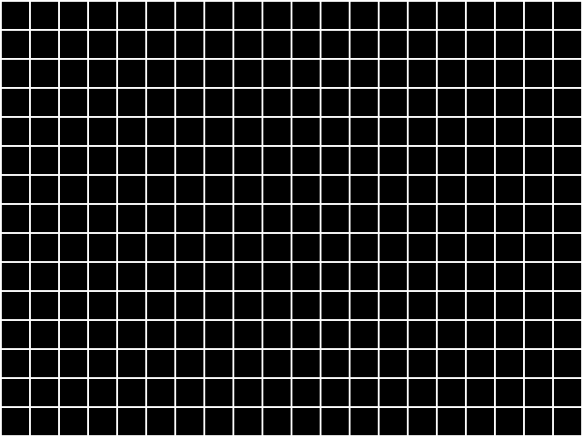<figcaption>測るのによい絵の例: 表示範囲の端まで線のあるグリッド</figcaption></figure>
</div>

- CAP RUN は、黒以外が出た範囲を表示範囲 (ACTIVE) とみなし、その幅と ACTIVE のドット数から H 合計・FP / SYNC / BP・ドットクロックを決めます。
- 絵の端に黒い余白があると表示範囲を狭く測り、推定が外れます (`DONE` の前の端数が大きくなる、`BAD HTOT`・`H NEG` になる、C.DOT がずれる)。黒い背景のゲームの画面・文字だけの画面・メニューの画面は向きません。
- 左右の端の列と、上下の端のラインに明るい点が出ていることが条件です。グリッドなら、一番外の線が表示範囲のちょうど端 (最初と最後のドット・ライン) にあるものを使います。
- 暗い色は黒とみなします (しきい値は黒と一番明るいところの中間)。白か明るい色の絵にしてください。
- ACTIVE を AUTO にするときは、V (ライン数) も絵の上端・下端から決めるので、上下の端まで絵があることが特に大事です。
- 測る機器にテストパターン (クロスハッチ・全面白など) の機能があれば、それを使うのが確実です。

### 測る手順

1. SYNC CAPTURE に入る (または MODE を `CAP SELF` (スイッチ IN では `CAP IN`) にして SEL で決定する)。カーソルが No.28 ACTIVE へ移る。
2. ACTIVE に入力の解像度 (表示のドット数 / ライン数) を予め入れる。SEL で H を変える状態に入り、もう一度 SEL で V、もう一度 SEL で決定して抜ける。STEP は増減幅 (×1 → ×10 → ×100) だけを切り替える (入るときは ×1、H から V へ移っても増減幅はそのまま)。分からなければ AUTO にする。値を変えなくても、一度決定する必要がある。
3. 決定するとカーソルが No.27 CAP RUN へ移る。ACTIVE を決定するまでは、CAP RUN が `*CAP RUN SET ACT` になり始められない。
4. 入力の機器に、四辺まで明るい絵 (全面の白・端まで線のあるグリッド) を出す (上の「測る前に」)。
5. CAP RUN で SEL。`THR` (しきい値を自動で合わせる) → `RUN` (測定中)。
6. 数秒 (480 ラインの 60Hz で 2〜10 秒ほど) 待つと、測定が自動で終わって `DONE` になる。途中でもう一度 SEL を押して早めに終えることもできる。`DONE` になれば推定できた。カーソルは No.31 COPY へ移る。
7. No.29 C.TOT (推定した H / V 合計) と No.30 C.DOT (推定したドットクロック) を見る。H の周期は 64 フィールド分 (60Hz で約 1 秒) の平均を使うので、CAP RUN を始めて約 1 秒たつと C.DOT の下の桁が落ち着く。
8. No.31 COPY で SEL すると、推定した値が作業中の設定に入る (名前 `CAPTURE`、TV OUT は OFF。MODE は変わらない)。カーソルが同じ一覧の No.25 APPLY へ移る。
9. APPLY で SEL すると確定する。入力モードのままでもよい。そのときは設定とクロックの切り替えだけ済ませ、出力は止まったまま。
10. 入力の機器のケーブルを外してから、入力モードを抜ける。抜けたところで、確定した設定ですぐ出力が始まる。
    - 切り替えスイッチを OUT に戻す。
    - ケーブルをつないだまま抜けると、相手の同期とぶつかるので出力を止めて APPLY に `CLASH` が出る。外してから APPLY で戻る。

CAP RUN の `RUN` / `DONE` の前の数 (`-12 DONE` など) は、推定した H 合計の丸める前の端数です (1/256 ドット単位)。0 に近いほど確かです。大きいときは ACTIVE が合っていないか、絵が端まで出ていません。

> [!TIP]
> 数字が大きいときは誤差大

<div class="shots">
<figure>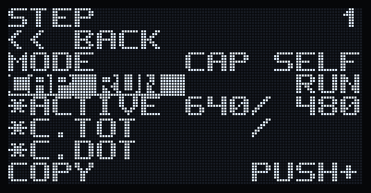<figcaption>CAP RUN の測定中 (<code>RUN</code>)</figcaption></figure>
<figure>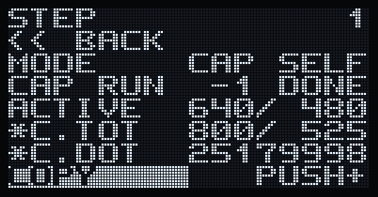<figcaption><code>DONE</code> (前の数は推定の端数)。カーソルは COPY、C.TOT / C.DOT に推定</figcaption></figure>
<figure>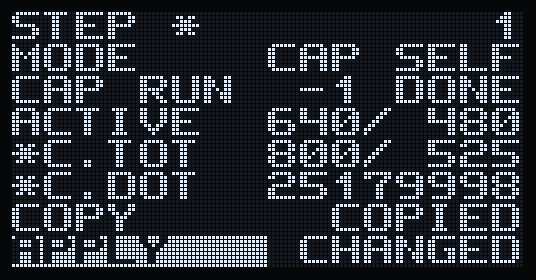<figcaption>COPY のあと: カーソルが APPLY へ移り <code>CHANGED</code></figcaption></figure>
</div>

### 解像度が分からないとき (AUTO)

ACTIVE で一番小さい値からさらに DOWN を押すと `AUTO` になります。AUTO にすると、H / V ACTIVE (No.2 / No.6) は値を変え始める前の値に戻ります (下げる途中の 8 や 1 は残りません)。UP で AUTO をやめると、その値が出ます。H / V 別々に選べます。

AUTO で推定した値 (`536?` のように ? 付き) が出ているときに UP / DOWN を押すと、推定した値から 1 段増減した値になり、AUTO はやめます (例: `536?` で UP → 537)。推定した値を手で少し直すときに使います。

- V の AUTO は、測った絵の上端・下端からライン数を決めます。絵が上下の端まであれば正確です。
- H の AUTO は、画面を 4:3 と仮定して V から決める暫定の値です。ドットが正方形でない機器では外れるので、分かるなら数字で入れてください。
- AUTO で推定した値には、数字の後ろに `?` が付きます。例: ACTIVE `640?/480?`、C.TOT `800?/ 525` (H 合計は H ACTIVE に依るので `?`)、C.DOT `25180029?`。

<div class="shots">
<figure>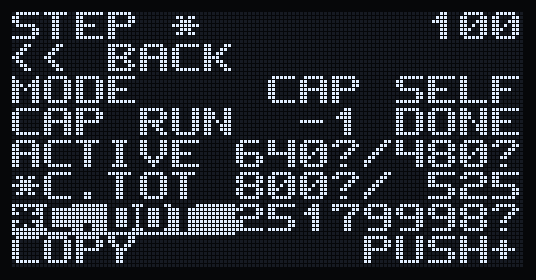<figcaption>ACTIVE を AUTO にして推定した値 (<code>?</code> 付き)</figcaption></figure>
</div>

### エラーと保護

| 表示 | 意味・対処 |
| --- | --- |
| `NO SYNC` | 同期が来ていない。つなぎ方、入力モードかどうかを確かめる |
| `ERROR` | 測定中に入力のライン数が変わった、絵が測れる範囲を超えたなど |
| `NO MEAS` | 同期の測定結果がない |
| `NO EDGE` | 絵の左右か上の端が見つからない (画面が黒い) |
| `BAD HTOT` | H 合計がおかしい |
| `H NEG` / `V NEG` | 推定した FP / BP がマイナスになった。ACTIVE が大きすぎる |
| `HI LEVEL` | 入力の映像が強すぎる (TTL の RGB を 75Ω で受けたなど)。終端を自動で切る。終端のスイッチを切る側にする |
| `NO DATA` | (COPY) DONE でない。または DONE のあとで ACTIVE を変えた |
| `RANGE NG` | (COPY) 推定した値が設定できる範囲の外 (同期の幅 0、FP / SYNC / BP の上限超え、DOTCLK が 1〜48MHz の外)。値を丸めると測ったタイミングが変わるので写さない。FP / BP の 0 はそのまま写す |
| `CLASH` (APPLY) | 出力モードなのに外から同期が来てぶつかったので、出力を止めた。つなぎ方を直して APPLY |

### 知っておくこと

- 測る単位は 10ns です。H 合計を整数に丸め、ドットクロックは H 合計 × 水平周波数で求めます。
- 同期の形式は SEP / OR / XOR を見分けます。EQ (等化パルス付き) は OR と測ります。作業中の SYNC が EQ のまま COPY すると、SYNC と EQ FORM はそのまま残るので、形は手で合わせます。
- 測定中 (THR / RUN) は ACTIVE を変えられません。
- 映像のしきい値は、黒と、絵の一番明るいところの中間に自動で合わせます。端がなまっても立ち上がり・立ち下がりの遅れがそろうので、幅を正しく測れます。そのかわり、一番明るいところの半分より暗い色は「黒」とみなすので、測るときは四辺まで白い (明るい) 絵を出してください。
- アナログ RGB を TTL (終端なし) で受けると、ケーブルの容量を相手の出力抵抗 (本機の出力は約 266Ω) だけで充放電するので端が大きくなまり、反射も乗ります。75Ω で受けてください。
- 同期の変わり目のすぐ近くに出る短いパルス (TTL の同期のノイズが RGB に飛び込んだもの) は、絵とみなしません。

## 12. 波形コピー (SYNC CAPTURE: MODE = CAP RAW)

入力の同期信号 (HSYNC / VSYNC / CSYNC) の形をそのまま記録し、ジェネレータの出力で再生します。等化パルスの形や半ラインのずれなど、設定で作れない変わった同期をキャプチャするときに使います。

### 先に合わせておくもの

記録するのは同期の変わり目の位置だけで、位置はジェネレータの H 合計でドット単位に直します。そのため、先に H / V 合計と DOTCLK を入力に合わせて APPLY しておきます (11 章の CAP RUN → COPY → APPLY が一番簡単)。

### 使い方

| No. | 項目 | 使い方 |
| --- | --- | --- |
| 27 | RAW REC | SEL で記録。`WAIT` (フィールドの区切りを待つ) → `REC` → `CONV` (ドットに直して圧縮) → `DONE` (`525 DONE` のように記録したライン数も出る)。プログレッシブは 1 フィールド、インターレースは 2 フィールド (1 フレーム) を記録する |
| 28 | RAW PLAY | SEL で値を変える状態に入り、UP / DOWN で `ON` / `OFF`、SEL で決定。`ON` で記録した同期を出力する (映像はテストパターン)。`OFF` で普通の同期に戻る。RAW REC・RAW LOAD のあとの APPLY が済むと自動で `ON` になる (APPLY が `CLK ERR` のときは ON にせず、次に成功した APPLY で ON) |
| 29 | RAW SLOT | 波形スロットの番号 1〜8 (SEL で入り、UP / DOWN で選び、SEL で決定)。ユーザープリセットの No.21 SLOT とは別 |
| 30 | RAW SAVE | SEL で、RAW SLOT の番号のスロットに、波形と今の作業中の設定 (ユーザープリセットと同じ内容: DOTCLK・H / V・同期の形式・極性・SYNC LV・VS OFS / EQ FORM・SCAN・TV OUT・名前) を一緒に保存する |
| 31 | RAW LOAD | SEL で、RAW SLOT の番号のスロットから波形と設定を読み出す。設定は作業中の値に入り、カーソルが APPLY へ移る |

1. 入力モードで機器をつなぎ、先に 11 章の手順で CAP RUN → COPY → APPLY をする (入力モードのままでよい。出力は止まったまま設定だけ確定する)。
   CAP RUN でしきい値も入力に合わせるので、プリセットで合わせられる機器でも CAP RUN をしておくと確実です。
2. SYNC CAPTURE の一覧で MODE を `CAP RAW` にして SEL で決定する。カーソルが No.27 RAW REC へ移る。
   COPY → APPLY をしていない (または COPY のあと値を変えて未確定・プリセットや LOAD で入れ替えた) ときは、RAW REC に `NEED CAP` が出る。
   そのまま SEL で記録もできるが、合計・ドットクロック・しきい値が入力と合っていないと正しく記録・再生できない。
3. RAW REC で SEL。`525 DONE` のように出たら、ライン数が入力と合っているか確かめる。
4. 入力を外して出力モードに戻し、APPLY を押すと RAW PLAY が `ON` になる (RAW REC のあとは 1 行目に `*`、APPLY に `CHANGED` が出ている)。手で ON / OFF もできる (SEL → UP → SEL)。
5. 残したいときは RAW SLOT で番号を選んで RAW SAVE。H / V 合計・DOTCLK などの設定も一緒に保存されます (ユーザープリセットの SAVE は要りません)。
6. 呼び出すときは MODE を `CAP RAW` にして、RAW SLOT で番号を選び RAW LOAD → APPLY。APPLY が済むと RAW PLAY が自動で `ON` になる。

RAW REC の表示: `NEED CAP` (CAP RUN → COPY → APPLY を勧める。記録はできる)、`FULL` (変わり目が多すぎて入りきらない)、`NO SYNC` (同期が来ない)。RAW SAVE / LOAD の表示はユーザープリセットの SAVE / LOAD と同じです。波形か設定のどちらかが壊れていれば RAW LOAD は `ERROR` で、作業中の値は変わりません。記録が 240 語を超えると RAW SAVE は `ERROR` です。

### 知っておくこと

- 同じ形のラインが続くところはまとめて圧縮します (例: 480i の 1050 か所の変わり目が 24 語)。保存できるのは 1 スロット 240 語までです。
- 波形スロットは 8 個で、ユーザープリセットとは別の場所に保存します。読み出しは合計を確かめ、壊れていれば `ERROR` です。
- APPLY の途中など、出力を止めているあいだは再生も止まります。

<div class="shots">
<figure>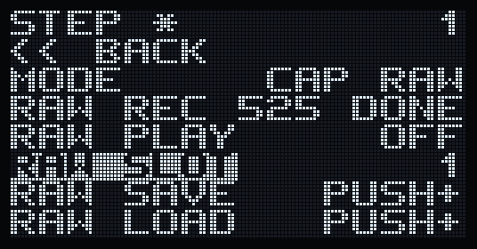<figcaption>RAW REC の <code>DONE</code> (ライン数 525)</figcaption></figure>
</div>

## 13. 困ったとき

まず OLED の APPLY の表示と VGA 出力の OSD を見て、出している設定と実測の周波数を確かめます。

| 症状 | 確かめること |
| --- | --- |
| 項目が見つからない | 最初の画面で機能を選んでいるか。タイミング・プリセット・保存・APPLY は SYNC SET/PATTERN、遅延測定は LAG CHECK、キャプチャは SYNC CAPTURE の一覧にある。`<< BACK` で最初の画面に戻る |
| 値を変えたのに出力が変わらない | APPLY したか。1 行目に `*` が残っていれば未確定 |
| COPY → APPLY したのに出力されない | 入力モード (切り替えスイッチが IN) のままでは出力しない。入力の機器のケーブルを外してからスイッチを OUT にすると、確定した設定で出力が始まる (APPLY のやり直しは要らない。11 章の手順 10) |
| APPLY が `CLK ERR` | もう一度 APPLY。直らなければ DOTCLK が 1〜48MHz の範囲か、MEAS が 0 でないか |
| VGA が映らない | モニタがその周波数に対応しているか (FRQ を見る)。SYNC LV を TTL にしてみる。複合同期ならモニタが CSYNC を受けられるか。入力モードになっていないか |
| 絵が左右・上下にずれる | FP / BP の配分を変える (合計は同じまま) |
| テレビが同期しない | FRQ の H が 15.73k / 15.63k か。FIX を使うと周波数がずれない |
| テレビが白黒 | テレビがその方式に対応しているか。SYNC + BP が短すぎるとバーストが入らない (約 8µs 以上必要)。S 端子ならケーブル |
| インターレースで縦に揺れる・ライン数が半分に見える | SCAN が INTER で APPLY されているか。V FP が 3 以上か |
| メニューの値が `----` | TV OUT 中は同期の項目を変えられない。TV OUT を OFF にして APPLY |
| VS OFS が変えられない | SYNC が EQ のときは No.14 が EQ FORM になる |
| SAVE が `ERROR` | 書き込みのあとの読み直しが合わなかった。もう一度 SAVE。続くなら EEPROM の故障 |
| CAP RUN が `*CAP RUN SET ACT` のまま | No.28 ACTIVE を SEL で入って、SEL で決定する |
| CAP RUN が `NO SYNC` | 入力モードか。入力の機器が映像を出しているか |
| CAP RUN の端数 (`-40 DONE` など) が大きい・H 合計がずれる | 終端のスイッチ。アナログ RGB を TTL で受けていないか (同期が TTL でも RGB がアナログなら 75Ω)。ACTIVE が合っているか、絵が四辺まで明るく出ているか |
| 遅延測定で `LOW SIG` | LAG MIN (黒) / LAG MAX (白) の電圧を見る。どちらも 0 付近ならセンサーの向き・配線・位置 |

電源を入れ直すと作業中の値は消えます。残したい設定はユーザープリセットに SAVE してください (スロット 1 は電源を入れたときに自動で読み込まれます)。

## 14. 仕様とメニュー項目一覧

### 仕様

| 項目 | 内容 |
| --- | --- |
| FPGA | Efinix Trion T20Q144 |
| ドットクロック | 1〜48MHz、1Hz 単位 (Si5351A、25MHz 水晶)。誤差 0.03ppm 以下 + 水晶の誤差 |
| 映像出力 | VGA (DE-15) と JAMMA。RGB 各 4 ビット (4096 色) |
| 同期 | 極性 POS / NEG、形式 SEP / OR / XOR / EQ、電圧 TTL (約 3.3V) / LOW (0.6V) |
| タイミング | H: 表示 8〜2000、FP 0〜512、SYNC 1〜512、BP 0〜1024 \[ドット\]。V: 表示 1〜2048、FP 0〜256、SYNC 1〜64、BP 0〜512 \[ライン\]。プログレッシブ / インターレース |
| テレビ出力 | コンポジット (RCA)、S 端子。NTSC / NTSC443 / PAL / PAL-M / PAL-N / PAL60、8 ビット DAC × 3 |
| 映像入力 | VGA 端子を切り替えて使う。RGB は色ごとのコンパレータ、同期は TTL / 低いレベル。測る単位 10ns |
| 操作・表示 | ボタン 4 個、OLED 128×64 (16 文字 × 8 行)、VGA 出力の OSD |
| 保存 | EEPROM 25LC640A。ユーザープリセット 8 個 + 波形 8 個 |
| 電源 | USB Type-C 5V |

### メニュー項目一覧

最初の画面の 3 つの一覧に、次の項目が並びます (どの一覧も一番上は `<< BACK`)。

**SYNC SET/PATTERN** (No.0〜25)

| No. | 項目 | No. | 項目 |
| --- | --- | --- | --- |
| 0 | DOTCLK | 16 | TOTAL (表示のみ) |
| 1 | MEAS (表示のみ) | 17 | FRQ (表示のみ) |
| 2〜5 | H ACTIVE / FP / SYNC / BP | 18 | PATTERN |
| 6〜9 | V ACTIVE / FP / SYNC / BP | 19 | PRESET |
| 10 / 11 | HS POL / VS POL | 20 | TV OUT |
| 12 | SYNC | 21〜24 | SLOT / NAME / LOAD / SAVE |
| 13 | SYNC LV | 25 | APPLY |
| 14 | VS OFS (EQ のとき EQ FORM) | | |
| 15 | SCAN | | |

**LAG CHECK**: No.26 MODE (LAG FULL / TOP / CENT / BOT)、No.27〜30 (下の表)

**SYNC CAPTURE**: No.26 MODE (CAP SELF (スイッチ IN では CAP IN) / CAP RAW)、No.27〜31 (下の表)、No.25 APPLY

| MODE | 27 | 28 | 29 | 30 | 31 |
| --- | --- | --- | --- | --- | --- |
| LAG FULL / TOP / CENT / BOT | LAG RUN | LAG AVG | LAG MIN | LAG MAX | (なし) |
| CAP SELF / CAP IN | CAP RUN | ACTIVE | C.TOT | C.DOT | COPY |
| CAP RAW | RAW REC | RAW PLAY | RAW SLOT | RAW SAVE | RAW LOAD |
